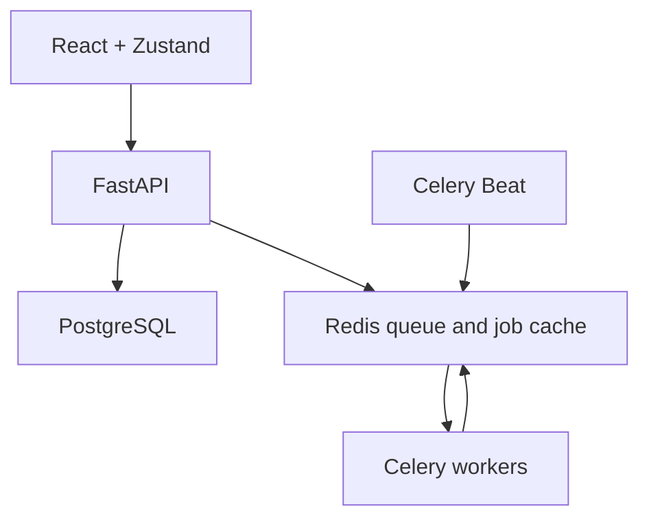
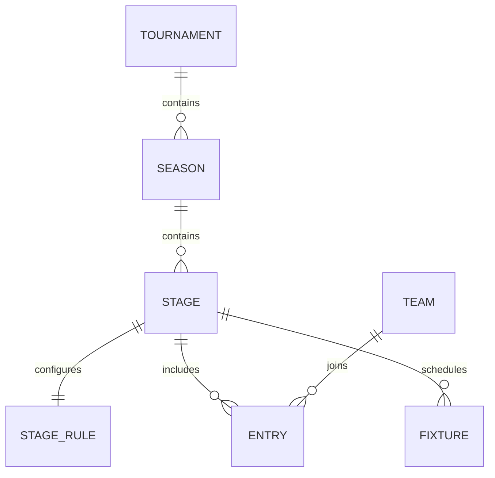

# Phases 1 and 2

## Phase 1: runtime foundation

The React/Zustand dashboard calls FastAPI through `/api`. It never receives external provider credentials. FastAPI reads relational state and validates scenario requests. Local development uses SQLite plus a bounded in-process runner; the target multi-process stack uses PostgreSQL, Redis and Celery. Work is queued independently of the HTTP request.

Compose provides dependency health checks, a persistent database and Redis volume, schema migration before API startup, a worker and one scheduler. Only the web/API ports bind to localhost. FastAPI uses database connection health checks and bounded PostgreSQL pooling. CORS origins and connection URLs are configured in the environment. Health endpoints expose no credentials.

| Endpoint | Meaning |
| --- | --- |
| `/api/health/live` | API process can answer a request |
| `/api/health/ready` | Database/schema and configured Redis are reachable |
| `/api/health` | Compatibility alias for readiness |

Readiness does not establish that a worker is consuming jobs. `scripts/smoke_stack.py --expect-mode celery` submits a real job and waits for its result to check that path.

The queue/cache identity includes stage content, rule values, revision, simulation inputs and an engine version. Rule/result changes cannot reuse an older snapshot's result. Local jobs are single-process, bounded and ephemeral; Redis/Celery is required for shared jobs across API processes.

The provider API is intentionally unconnected until Phase 3. The scheduler currently refreshes prediction baselines, not external fixtures. Public ingress controls, distributed queue admission, deployment and load testing remain later hardening work.

## Phase 2: universal configuration

The `stage_rules` table is authoritative. Its columns contain team count, optional matches per team, qualifying places, point awards, ordered tie-breakers, stage format, regulation overs, schedule completeness and schema version. The legacy `stages.rules` JSON column is retained for compatibility and backfill; application reads use the dedicated table. Operator rule updates keep the compatibility field in sync.

Configuration is scoped to season stages, including individual groups. League names never determine counts or rules. Four explicitly illustrative templates describe IPL-style, BBL-style, PSL-style and World Cup group setups.

Provisioning accepts a versioned JSON configuration and validates references and fixture totals before writing. Reprovisioning cannot overwrite an existing season. Rule updates use optimistic revision checks; readers see the complete old or complete new state. Fresh or migrated databases have checks rejecting invalid scoring, self-matches, invalid outcomes and fixture teams without membership in the relevant stage. Additive local-demo initialization backfills rules but does not rebuild existing tables to install new constraints; use the migrations for full schema upgrades.

Fresh demo schedules have 14/10/10 matches per team for the three league examples, and three per team in each World Cup group. Existing demos are preserved; backfill derives their counts from stored fixtures and does not fabricate missing matches or erase results.

Current support is limited to 2–16 teams per stage and 2/0/1 win/loss/washout points. Supported tie-break fields are wins and NRR. Further official tie-break criteria, team penalties, stage advancement and score-based NRR calculation are not implemented. Incomplete drafts cannot be used for predictions.

## Verification boundaries

The local rules/database tests use SQLite, including foreign-key enforcement and rollback checks. PostgreSQL, migrations, Redis/Celery, frontend builds and HTTP smoke checks have a CI workflow, but that workflow has not run merely because its file exists. See `VERIFICATION.md` for evidence from this workstation.
